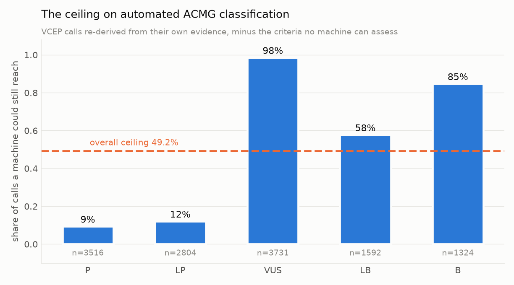
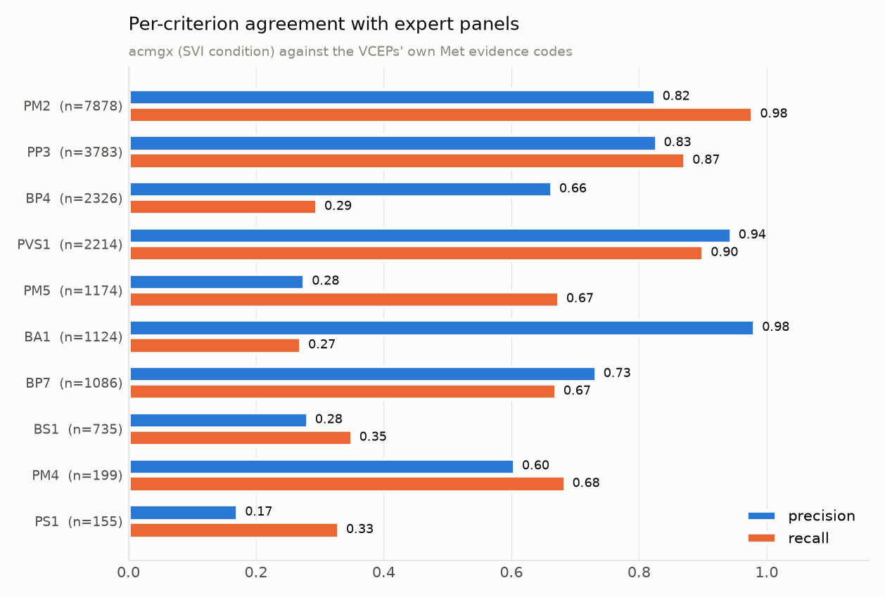
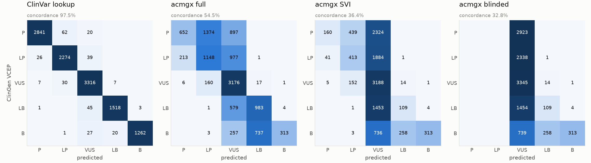
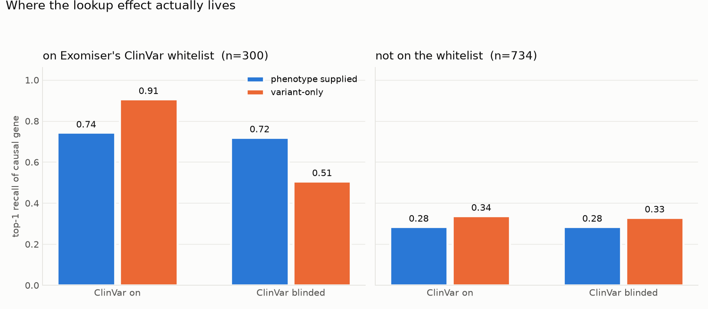
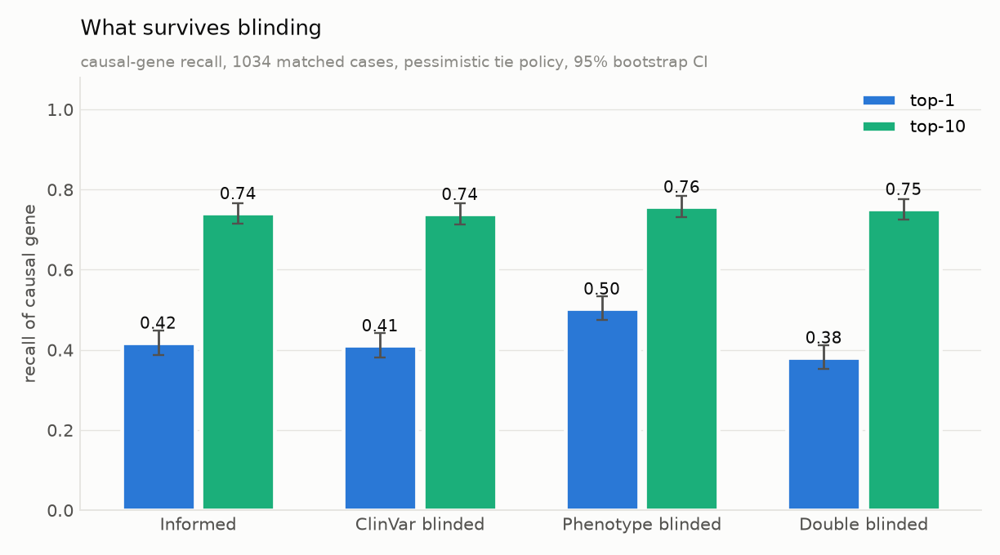
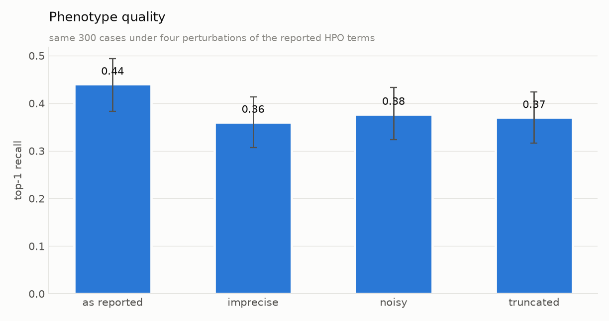
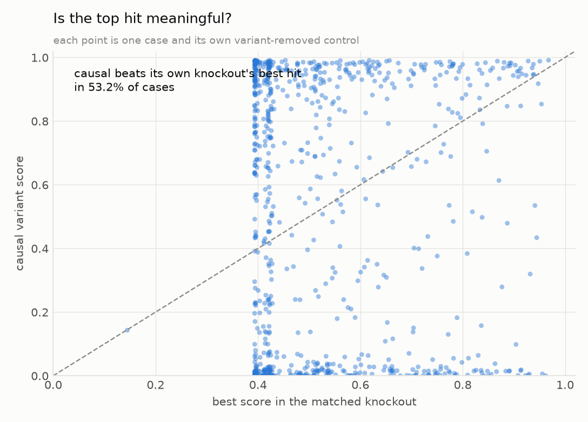

# Results

> **How much of automated rare-disease variant interpretation is knowledge-base recall rather than
> inference?**
>
> In classification, almost all of it. A "classifier" that ignores the variant entirely and returns
> ClinVar's aggregate call agrees with ClinGen expert panels on **97.5%** of 11,499 variants
> (95% CI 97.2–97.8). A real ACMG engine run under current ClinGen guidance, which may not read
> ClinVar assertions, reaches **36.4%** (35.5–37.3). The 61-point gap is not a measure of the
> engine. It is a measure of how much of the answer was already written down.
>
> And the engine is not the binding constraint either. Re-running each expert panel's **own**
> evidence with the criteria no machine can assess removed — functional assays, segregation,
> case-control data, de novo confirmation, phenotype specificity — reproduces the panel's tier for
> only **51.1%** of the 11,499 variants Arm B classifies (**49.2%** across all 12,967 expert
> interpretations, including those that do not resolve to GRCh38 coordinates). That is a ceiling on
> any automated classifier, however well built. Nine percent of *Pathogenic* calls and twelve
> percent of *Likely pathogenic* calls survive it.

---

## Arm B′ — the ceiling

Take each of the 12,967 ClinGen Evidence Repository interpretations, keep only the evidence codes an
automated system could assess, re-run the ACMG combining rules, and record what tier survives.

**Validation first.** Given *all* of a panel's evidence codes, our implementation of the 2015
combining rules reproduces the panel's published tier for **92.2%** of interpretations. The
remaining 7.8% is mostly gene-specific combining rules that depart from the 2015 defaults. That
agreement is what makes the subtraction below meaningful.

| | Concordance with the expert panel's own call |
|---|---|
| All of the panel's evidence | 92.2% |
| Machine-assessable + ClinVar-derived evidence only | **49.2%** |
| Machine-assessable evidence only | 44.9% |

**Two ceiling numbers appear in this document and they are not the same denominator.** 49.2% is
over all 12,967 ERepo interpretations, which is the number to quote for the framework as a whole.
51.1% is over the 11,499 of them that resolve to GRCh38 coordinates and are actually classified in
Arm B, and is the number to compare against `acmgx`. The 1.9-point difference is the variants that
drop out of the coordinate join, which skew slightly harder.

**62.8% of expert interpretations depend on at least one criterion no automated system can assess.**

Where the evidence goes, by tier:

| Expert tier | n | Retained at the ceiling | Most common downgrade |
|---|---|---|---|
| Pathogenic | 3,516 | **9.3%** | → VUS (2,676), → LP (509) |
| Likely pathogenic | 2,804 | **12.0%** | → VUS (2,460) |
| VUS | 3,731 | 98.5% | — |
| Likely benign | 1,592 | 57.7% | → VUS (661) |
| Benign | 1,324 | 84.7% | → VUS (129) |

The asymmetry is the finding. Benign calls survive automation because the evidence that makes a
variant benign — population frequency above a threshold — is exactly the kind a machine has.
Pathogenic calls do not survive, because what makes a variant pathogenic in a curated setting is
functional data, segregation in families, and de novo occurrence in probands. Of ~41,000 evidence
codes applied across the corpus, **37.0% are of a kind no pipeline can generate**.

The most-used codes tell the same story: after `PM2` (9,285 uses, machine-assessable) come `PP4`
(4,378, phenotype specificity), `PP3` (4,339, machine-assessable), `PVS1` (2,878,
machine-assessable), `PM3` (2,667, allelic data from patients) and `PS4` (2,477, case-control).

---

## Arm B — classification under blinding

`acmgx`, this repo's ACMG engine, run over the same 11,499 ERepo variants that resolve to GRCh38
coordinates, under three conditions plus a lookup baseline.

| | Concordance | 95% CI |
|---|---|---|
| **ClinVar lookup baseline** — returns ClinVar's aggregate call, no reasoning | **97.5%** | 97.2–97.8 |
| `acmgx full` — every criterion including the deprecated PP5/BP6 | 54.5% | 53.6–55.5 |
| *(the ceiling, for reference)* | *51.1%* | *50.2–52.0* |
| `acmgx svi` — current ClinGen guidance: no PP5/BP6 | **36.4%** | 35.5–37.3 |
| `acmgx blind` — no ClinVar-derived criteria at all | 32.8% | 31.9–33.6 |

Three things to read here.

**The lookup baseline is definitional, and that is the point.** ClinGen expert-panel
interpretations are submitted to ClinVar as three-star records, so for these variants ClinVar's
aggregate classification is largely the panel's own call echoed back. 97.5% is not a surprising
empirical result; it is what "benchmarking against a database the tool can read" means, stated as a
number. Any published concordance figure for a tool with ClinVar access has to be read against it.

**`acmgx full` scores above the ceiling.** 54.5% against a ceiling of 51.1% is not an error — it is
the signature of leakage. PP5 and BP6 let the engine short-circuit the evidence and read the
answer, so it can reach tiers the underlying evidence does not support. This is precisely why
ClinGen SVI deprecated them, and why v1's framing of the PP5/BP6-enabled run as the baseline and
the disabled run as "corrected" had it backwards.

**Removing PS1/PM5 costs little; removing PP5/BP6 costs everything.** The `svi` → `blind` step
drops 3.6 points (573 variants lost against 157 gained, McNemar p = 2×10⁻⁵⁶), against 18.1 points
for `full` → `svi`. ClinVar leakage in rule-based classification is concentrated almost entirely in
the reputable-source criteria that ClinGen has already deprecated.

### Where the VUS goes

| | Share of variants called VUS |
|---|---|
| Expert panels | 29.2% |
| ClinVar lookup | 30.0% |
| `acmgx full` | 51.2% |
| `acmgx svi` | **83.4%** |
| `acmgx blind` | 93.9% |

A compliant automated engine denied the un-automatable evidence calls almost everything uncertain.
This is the well-known VUS over-calling of rule-based tools, quantified: not a tuning problem, but
the direct consequence of the evidence types it cannot reach.

### When the evidence is actually available

Restricting to the **4,518 variants whose expert call used no unassessable evidence at all**:

| | Concordance |
|---|---|
| `acmgx full` | 72.1% |
| `acmgx svi` | 52.1% |
| `acmgx blind` | 52.8% |

Performance roughly doubles. And here the blinded engine is not merely as good as the SVI-compliant
one — it is **significantly better** (93 variants gained against 62 lost, McNemar p = 0.016).

That inversion is worth stating plainly, because it is the opposite of what "more evidence is
better" predicts. The mechanism is visible in the calls that change: PS1 and PM5 push variants from
VUS up to LP or P, and on this subset 115 of those pushes were wrong against 62 right — the panel
had called them VUS or benign. PM5 as implemented fires 2,873 times where panels used it 1,174
(precision 0.28), because asking whether *some* pathogenic change exists at a residue is a weaker
question than asking whether the mechanism transfers to this one.

So on the variants where automation is actually in play, the ClinVar-derived criteria are not
merely circular. As a generic implementation can express them, they are actively harmful.

Automated ACMG classification is not broadly weak; it is weak exactly where the evidence lives
outside the machine's reach.

### Per criterion

| Criterion | VCEP uses | acmgx fires | Precision | Recall | F1 |
|---|---|---|---|---|---|
| PVS1 | 2,214 | 2,112 | 0.94 | 0.90 | **0.92** |
| PM2 | 7,878 | 9,339 | 0.82 | 0.98 | **0.89** |
| PP3 | 3,783 | 3,988 | 0.83 | 0.87 | **0.85** |
| BP7 | 1,086 | 993 | 0.73 | 0.67 | 0.70 |
| PM4 | 199 | 225 | 0.60 | 0.68 | 0.64 |
| BA1 | 1,124 | 309 | 0.98 | 0.27 | 0.42 |
| BP4 | 2,326 | 1,035 | 0.66 | 0.29 | 0.41 |
| PM5 | 1,174 | 2,873 | 0.28 | 0.67 | 0.39 |
| BS1 | 735 | 917 | 0.28 | 0.35 | 0.31 |
| PS1 | 155 | 299 | 0.17 | 0.33 | 0.22 |

The criteria that automate well are the ones with a calibrated, gene-independent definition: PVS1
against a decision tree over real exon structure, PM2 against a filtering allele frequency, PP3
against a calibrated predictor threshold.

The failures are informative and mostly point the same direction. **BA1 has precision 0.98 but
recall 0.27**: when acmgx fires it, it is right, but it fires on only 309 of 1,124 expert uses,
because we apply the generic 5% threshold and panels apply gene-specific ones that are far lower.
**BS1 (precision 0.28) is the same problem, worse**, because BS1 is *defined* per gene-disease pair
and a single generic threshold cannot approximate it. **PS1 and PM5 over-fire** (299 vs 155; 2,873
vs 1,174) because we ask only whether a pathogenic change exists at the residue, where a panel also
asks whether the mechanism transfers.

None of these is a bug to be tuned away. They are the measurable cost of running generic rules
against gene-specific expert specifications.

### By expert panel

Aggregates hide a very wide spread. Selected panels, largest first:

| Panel | n | Lookup | `svi` | Ceiling | Ceiling − `svi` |
|---|---|---|---|---|---|
| Myeloid Malignancy | 1,518 | 99.5% | 50.1% | 93.1% | **43.0** |
| Monogenic Diabetes | 744 | 98.9% | 36.0% | 41.3% | 5.3 |
| Phenylketonuria | 603 | 99.3% | 35.3% | 27.5% | −7.8 |
| Familial Hypercholesterolemia | 549 | 99.3% | 61.9% | 64.5% | 2.6 |
| Rett and Angelman-like | 492 | 99.8% | 16.5% | 43.9% | 27.4 |
| RASopathy | 390 | 97.4% | 16.9% | 53.3% | 36.4 |
| Limb Girdle Muscular Dystrophy | 404 | 100.0% | 12.9% | 20.0% | 7.1 |
| CDH1 | 327 | 99.7% | 20.5% | 63.6% | 43.1 |
| Malignant Hyperthermia | 295 | 98.6% | 61.4% | 65.1% | 3.7 |
| TP53 | 180 | 100.0% | 21.7% | 21.7% | 0.0 |

The last column separates the two failure modes the aggregate conflates. Where it is small — TP53,
Malignant Hyperthermia, Familial Hypercholesterolemia — the engine is already at the ceiling and
better software would not help; the evidence simply is not machine-accessible. Where it is large —
Myeloid Malignancy, CDH1, RASopathy — the evidence *is* available and the generic engine is leaving
it on the table, mostly through gene-specific frequency thresholds and hotspot criteria it does not
implement.

The lookup column is above 92% in every panel, which is what makes the whole comparison necessary.

### By consequence

| Consequence | n | `svi` | Ceiling |
|---|---|---|---|
| missense | 6,547 | 45.3% | 49.5% |
| synonymous | 1,066 | 22.1% | 85.9% |
| frameshift | 905 | 7.1% | 29.3% |
| intron | 817 | 30.7% | 71.4% |
| nonsense | 701 | 25.8% | 20.0% |
| splice donor | 325 | 11.4% | 28.3% |

Missense variants are where automation is closest to its ceiling (45.3% against 49.5%), because
that is where the calibrated predictor evidence lives. Synonymous and intronic variants show the
largest headroom — an 86% ceiling against 22% achieved for synonymous — and the reason is
identifiable: BP7 here uses a distance-to-boundary heuristic rather than SpliceAI, so benign
synonymous variants that a panel confidently excludes are left as VUS. That is a fixable
implementation gap, and the ceiling analysis is what makes it visible as one.

---

## Arm A — prioritization under blinding

1,034 cases, real published-patient phenotypes, causal alleles spiked into the GIAB trio, each with
a matched knockout. Ranking is of the causal **gene** — Exomiser scores per gene, and every variant
in a gene inherits that score, so a variant-level rank counts a gene's other alleles against the
causal one (see `docs/decisions.md` D-019). Pessimistic tie policy throughout.

| Condition | ClinVar | Phenotype | top-1 | top-10 | MRR | survived filters |
|---|---|---|---|---|---|---|
| `informed` | on | on | 0.418 [0.388,0.448] | 0.741 [0.714,0.766] | 0.533 | 0.785 |
| `clinvar_blind` | **off** | on | 0.411 [0.380,0.441] | 0.739 [0.713,0.765] | 0.528 | 0.783 |
| `pheno_blind` | on | **off** | 0.503 [0.474,0.534] | 0.757 [0.731,0.783] | 0.596 | 0.784 |
| `double_blind` | **off** | **off** | 0.381 [0.353,0.411] | 0.751 [0.725,0.777] | 0.521 | 0.782 |

Ties are not doing any work here: gene-level top-1 is 0.418 under both the pessimistic and the
optimistic policy.

### The marginal ClinVar delta is a trap

Comparing `informed` against `clinvar_blind` gives **+0.007** top-1. Taken at face value that says
Exomiser's ClinVar whitelist does not drive prioritization — which was the opposite of this
project's working hypothesis, and it is wrong.

Only 300 of 1,034 causal alleles are on the whitelist, and phenotype scoring masks the effect on
those. Splitting the 2×2 by whitelist membership:

**Whitelisted causal alleles (n=300)**

| | ClinVar on | ClinVar blinded |
|---|---|---|
| phenotype supplied | 0.743 | 0.720 |
| **variant-only** | **0.907** | **0.507** |

**Not whitelisted (n=734)**

| | ClinVar on | ClinVar blinded |
|---|---|---|
| phenotype supplied | 0.285 | 0.285 |
| variant-only | 0.338 | 0.330 |

Where the lookup applies it is worth **+0.400 top-1**. Where it does not, the delta is exactly
zero — the lower table is an internal control confirming that blinding touches only the variants it
should.

So the hypothesis holds, but only for the 29% of causal alleles ClinVar covers, and only once you
stop averaging over the variants where the mechanism cannot operate. A benchmark built the way v1
specified — spiking ClinVar P/LP variants — would have drawn most of its cases from variants ClinVar
already classifies, and reported the blend as diagnostic performance. 63.6% of the causal alleles
here are ClinVar P/LP (D-005); 29.0% were on Exomiser's whitelist at runtime. Those are different
numbers and the gap is not fully explained — see `docs/limitations.md`.

### Phenotype helps or hurts depending on ClinVar

| Phenotype supplied − variant-only | delta (top-1) | p |
|---|---|---|
| with ClinVar **on** | **−0.085** [−0.115,−0.056] | 6×10⁻⁸ |
| with ClinVar **off** | +0.030 [−0.004,+0.063] | 0.10 |

Supplying real patient phenotypes makes top-1 *worse* when ClinVar is informing the variant score,
and slightly better when it is not. Stated as a main effect — "phenotype ranking hurts" — this would
be false; it is an interaction.

The mechanism is legible. The whitelist pins a causal variant's score at maximum, so ranking on
variant score alone puts the causal gene first 90.7% of the time. Blending in a phenotype score
that is usually below 1.0 can only dilute a signal that is already saturated. Real case-report
phenotypes are sparse — median 7 terms — so the causal gene's phenotype score frequently is below 1.

Two things follow. Exomiser's own documentation warns that running without phenotype prioritisation
gives sub-optimal results, and on the variants it cannot look up (n=734) that is borne out — but the
margin is small (0.28 vs 0.34, in favour of variant-only, both far below the whitelisted cases). And
a benchmark that reports one aggregate number cannot see any of this.

### Inheritance: the filter is the story, not the ranker

| Model | n | survived the cascade | top-1 | top-10 |
|---|---|---|---|---|
| de novo | 266 | 0.989 | 0.673 [0.617,0.729] | 0.951 |
| AR homozygous | 352 | 1.000 | 0.472 [0.420,0.523] | 0.952 |
| compound het | 189 | 0.995 | 0.460 [0.386,0.529] | 0.926 |
| inherited dominant | 227 | **0.040** | 0.000 | 0.013 |

The inherited-dominant arm did not fail at ranking — the causal allele was **removed by the
inheritance filter in 96% of cases**, and never reached the ranker. That is Exomiser behaving
correctly on a case construction that was wrong: a heterozygous parent carrying a dominant
pathogenic allele and coded unaffected is a non-penetrant carrier, which `AUTOSOMAL_DOMINANT`
rejects by design.

Re-running the same 227 cases with the transmitting parent coded **affected**:

| | survived | top-1 | top-10 |
|---|---|---|---|
| parent coded unaffected | 0.040 | 0.000 | 0.013 |
| parent coded affected | **0.996** | **0.700** | **0.916** |
| delta | +0.956 | **+0.700** [+0.639,+0.758] | +0.903 [+0.863,+0.943] |

That is what the trio inheritance filter costs under incomplete penetrance, measured rather than
asserted: a 70-point swing in top-1 from a single character in the pedigree file. It is also the
strongest single effect anywhere in this project — larger than ClinVar lookup, larger than
phenotype. For a real dominant condition with reduced penetrance, or an unexamined parent, the
standard trio filter discards the answer before anything scores it.

### Phenotype quality

Same 300 cases, the reported HPO terms perturbed:

| Tier | top-1 | delta vs as reported |
|---|---|---|
| as reported | 0.440 | — |
| imprecise (generalised 2 levels) | 0.360 | −0.080 [−0.113,−0.047] |
| noisy (unrelated terms added) | 0.377 | −0.063 [−0.093,−0.037] |
| truncated (a third of terms kept) | 0.370 | −0.070 [−0.107,−0.037] |

All three degrade top-1 by 6–8 points and leave top-10 essentially untouched (0.72–0.73
throughout). Phenotype quality reshuffles the top of the list; it does not change what is on it.

### Matched knockouts

Every case has a twin with the causal variant deleted — same genome, same phenotypes.

The causal variant outscores the best hit in its own knockout in **41.8%** [38.8,44.8] of cases.
Median causal score is 0.224 against a median best-knockout score of 0.482. In more than half of
cases the healthy background produces a better-scoring candidate than the true answer.

**That statistic is arithmetically identical to top-1, not independent of it.** The knockout VCF is
the background alone and the positive is the background plus the causal allele, so "causal beats
the knockout's best hit" and "causal gene is ranked first" are the same event. They agree on
1,034/1,034 cases in both conditions, and `tests/test_results_integrity.py` asserts the identity so
it cannot be quietly presented as a second measurement.

What the knockout does add independently is the **absolute** score of the top hit when there is
nothing to find: median 0.482, on the same 0-1 scale that a true causal variant reaches 0.224.
A reviewer handed the knockout's ranked list has no score-based signal that the case is unsolved.
The median candidate list is 88 variants across 51 genes either way.

### Filter attrition

Constant across cases, since all share one background: **42,779** variants loaded → **1,229** pass
the variant filters (frequency at 2%, non-coding pathogenicity, failed-variant) → **88** variants
across **51** genes survive the inheritance filter and are ranked. The causal allele survives in
78.5% of cases overall, and in 99–100% of every inheritance model except inherited dominant.

---

## What this supports

**A benchmark number without a lookup baseline beside it is uninterpretable.** In classification the
baseline is 97.5% and it reasons about nothing. In prioritization it is worth 40 points of top-1 on
the variants it covers. Neither is visible in a single aggregate figure, and v1's design would have
reported the blend as performance.

**The ceiling, not the software, is the binding constraint on automated ACMG classification.**
Re-running the expert panels' own evidence without the criteria no machine can assess reproduces
their tier for 49.2% of interpretations, and for only 9.3% of Pathogenic calls. A compliant engine
reaches 36.4%. Better software closes the 13-point gap; it cannot touch the other 51.

**Automated interpretation is not uniformly weak — it is weak in an identifiable place.** Benign
calls survive automation (85%) because benignity rests on population frequency. Pathogenic calls do
not (9%) because pathogenicity rests on functional assays, family segregation, and de novo
confirmation. On the 4,518 variants whose expert call needed none of that, concordance roughly
doubles. The gap is about evidence types, not algorithms.

**The largest effect measured here was not a knowledge-base effect at all.** It was the trio
inheritance filter discarding inherited-dominant cases when the transmitting parent is recorded
unaffected: 96% of causal alleles removed, a 70-point top-1 swing. Filter design under incomplete
penetrance deserves more attention than the ranking algorithm it feeds.

**Where automated interpretation can and cannot replace expert review.** It can triage: top-10
recall is 0.74–0.76 across every blinding condition, and stable under phenotype perturbation. It
can call variants benign. It cannot call variants pathogenic — not because the tools are bad, but
because the evidence that establishes pathogenicity is generated in laboratories and clinics, not
computed from a VCF. Reported concordance figures above the ceiling should be read as evidence of
database access, not of capability.
